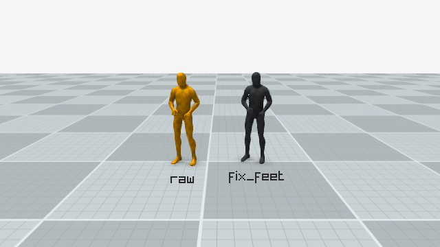
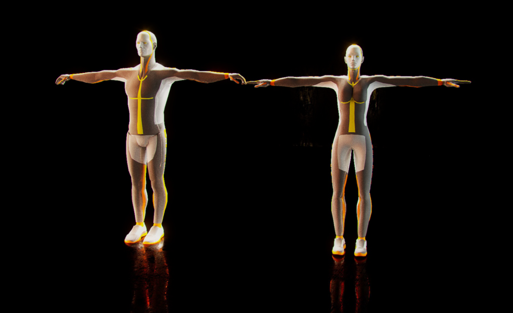

<div align="center">

# ZeroEGGS

### Zero-shot Example-based Gesture Generation from Speech

[](https://doi.org/10.1111/cgf.14734)
[](https://arxiv.org/abs/2209.07556)
[](https://www.youtube.com/watch?v=YFg7QKWkjwQ)
[](License.md)


[](https://www.youtube.com/watch?v=YFg7QKWkjwQ "Watch the video demo")

</div>

ZeroEGGS turns speech audio into full-body gesture animation (BVH) in the style of a short motion example, including
styles it never saw in training. This repository has the code, pretrained models and the ZEGGS dataset: 135 minutes
of motion-captured monologues in 19 styles.

- **Zero-shot style control.** Give it a few seconds of motion in any style and it gestures that way.
- **Blending and transitions.** Mix styles, or move from one style to another within a clip.
- **Variation on demand.** The style space is probabilistic, so the same speech gives different takes (see `--temperature`).
- **Clean feet.** Optional post-processing removes foot sliding from the generated motion (`--fix_feet`).
- **Dataset included.** 67 takes by one actor with aligned audio and BVH, plus mirrored versions.

## What's new

- **2026-11:** A skinned-character viewer and video recorder (`tools/genoview`) and `zeggs-retarget` for the Geno
  character.
- **2026-11:** Foot sliding cleanup. `--fix_feet` pins planted feet and re-solves the legs with IK, and
  `zeggs-fix-feet` does the same for any BVH and reports a foot-skating score (see [below](#foot-sliding-cleanup)).
- **2026-11:** Runs on Python 3.12 and PyTorch 2.x, on CUDA, Apple Silicon (MPS) or CPU, with no system packages.
  The code is now an installable `zeggs` package with command-line tools, safe-loading checkpoints and tests that
  check generation against the original code.

## Quickstart

```sh
git clone https://github.com/ubisoft/ubisoft-laforge-ZeroEGGS.git && cd ubisoft-laforge-ZeroEGGS
python -m venv .venv && source .venv/bin/activate && pip install -e ".[dev]"
zeggs-generate -o data/outputs/v1/options.json -s <style.bvh> -a <speech.wav> --fix_feet
```

The result lands in `data/outputs/v1/results/` as a BVH plus a copy of the audio. Any 60 fps BVH on the ZEGGS skeleton
works as the style example (the dataset below has 19 styles to start from), and any WAV works as speech.

## Pretrained models

| Model | Style input | Command |
|-------|-------------|---------|
| `v1` | a motion example (BVH, optional frame range `-f start end`) | `zeggs-generate -o data/outputs/v1/options.json -s style.bvh -a speech.wav` |
| `v2` | a style name, trained on 9 styles (Happy, Old, Disagreement, Sad, Speech, Relaxed, Neutral, Agreement, Angry) | `zeggs-generate -o data/outputs/v2/options.json -se label -s Happy -fp first_pose.bvh -a speech.wav` |

## Environment Setup

Python 3.10+ and PyTorch 2.4+ on Linux, macOS or Windows. No system packages are needed. From the repository root:

```sh
python -m venv .venv
source .venv/bin/activate
pip install -e ".[dev]"
```

All commands below run from the repository root; paths in the configs are relative to it.
Devices: `use_gpu` picks CUDA, then Apple MPS, then CPU.

## ZEGGS Dataset

<div align="center"> 


</div>
ZEGGS dataset contains 67 sequences of monologues performed by a female actor speaking in English and covers 19 different motion styles. 

The following styles are present in the ZEGGS dataset:

<div align="center">  

| **Style** | **Length (mins)** | **Style** | **Length (mins)** |
|--------------|-----------------------|-------|---------------|
| Agreement    | 5.25                  | Pensive | 6.21          |
| Angry        | 7.95                  | Relaxed | 10.81         |
| Disagreement | 5.33                  | Sad   | 11.80         |
| Distracted   | 5.29                  | Sarcastic | 6.52          |
| Flirty       | 3.27                  | Scared | 5.58          |
| Happy        | 10.08                 | Sneaky | 6.27          |
| Laughing     | 3.85                  | Still | 5.33          |
| Oration      | 3.98                  | Threatening | 5.84          |
| Neutral      | 11.13                 | Tired | 7.13          |
| Old          | 11.37                 | Total | 134.65        |

</div>  
    
### Access to the data

The speech and gesture data are in `data/Zeggs_data.zip`, `data/Zeggs_data.z01` and `data/Zeggs_data.z02`, stored with
[Git LFS](https://git-lfs.com). Either clone with Git LFS, or download the three parts directly (about 2.8 GB) and
check them against the `sha256` in each LFS pointer file:

```sh
for f in Zeggs_data.zip Zeggs_data.z01 Zeggs_data.z02; do
  curl -L -o $f https://media.githubusercontent.com/media/ubisoft/ubisoft-laforge-ZeroEGGS/main/data/$f
done
zip -s 0 Zeggs_data.zip --out joined.zip && unzip joined.zip -d data && rm joined.zip
```

When you extract the zip file, there are two folders:

- `original` folder contains the original data where the animation and audio files are in their raw version and not
  processed.

- `clean` contains aligned animation and audio data and without unwanted audio of other speaker. For more details on how
  these files have been processed check `zeggs/data_pipeline.py`

All the animation sequences are in the BVH file format and all the audio data are in WAV format.

## Data Preparation

With `data/original` in place, run:

```sh
zeggs-preprocess -c configs/data_pipeline_conf_v1.json
```

This writes the training files to the `processed_data_path` folder of the config. Two configurations are provided in
`configs`. `--info <csv>` processes a subset of takes (same columns as `data/info.csv`).

## Training

Pre-trained models are in `data/outputs/v1` (example-based) and `data/outputs/v2` (label-based). To train from scratch:

```sh
zeggs-train -o configs/configs_v1.json -n zeggs_v1
```

Each run saves its options, a copy of the code, TensorBoard logs, sample BVHs and checkpoints. Set
`"resume": true` and `models_dir` in the options to continue a run.

Checkpoints are `{class, config, state_dict}` files loaded with `torch.load(weights_only=True)`. Weights pickled by
the original code can be converted once with `python -m zeggs.checkpoint <models_dir>` (the shipped models already
are).

## Inference

After training is finished or using provided pretrained models (provided in `data/outputs`), you can generate gestures
given speech and style as input using `zeggs-generate`. The output will be saved in `bvh` format. For full
functionality (blending, transitions, using pre-extracted style encodings, etc.) use the `generate_gesture` function in
`zeggs/generate.py`. Otherwise, you can use the CLI as explained below.

### Using the CLI

#### 1. Generating a single sample from a single audio/style pair

```sh
zeggs-generate -o data/outputs/v1/options.json -s data/clean/067_Speech_2_x_1_0.bvh -a data/clean/067_Speech_2_x_1_0.wav
```

`options file` is the one saved by training; it points to the models and processed data. The label-based model takes
a style name and a first pose:

```sh
zeggs-generate -o data/outputs/v2/options.json -se label -s Happy -fp data/clean/067_Speech_2_x_1_0.bvh -a data/clean/067_Speech_2_x_1_0.wav
```

Run `zeggs-generate -h` for the seed, temperature, output name and other options.

#### 2. Generating a batch of samples from a CSV file

```sh
zeggs-generate -o data/outputs/v1/options.json -c data/test/evaluation_example_based.csv
```

### Foot sliding cleanup

<div align="center">



</div>

Generated feet tend to slide while planted, and sometimes the whole body glides with them. `--fix_feet` first moves
the root back by the drift of the planted feet (removing whole-body skating), then pins each planted foot (detected
from ankle height and speed) and re-solves the legs with two-bone IK, lowering the hips slightly when a pinned foot is
out of reach:

```sh
zeggs-generate -o data/outputs/v1/options.json -s style.bvh -a speech.wav --fix_feet
```

It also works on any BVH on the ZEGGS skeleton, and prints a foot-skating score (horizontal speed of feet near the
floor) before and after:

```sh
zeggs-fix-feet input.bvh output.bvh
```

Generated motion can also slowly turn away from the camera, because the model integrates its own turning speed.
`--fix_heading` (or `zeggs-fix-feet --heading`) keeps turns faster than a few seconds and limits the slow trend to 20
degrees from the starting direction (about what mocap wanders; `max_deviation` changes it), turning the body around the point between the feet. Use both flags together.
Note that the skating score counts real steps too, so lively takes, mocap included, can score several cm/s.

| Clip (same speech and seed for each pair) | Without | With `--fix_feet` |
|------|---------|-------------------|
| v1, example-based (147 s) | 3.1 cm/s, 68% of low-foot frames moving | 0.0 cm/s, 0% |
| v2, label-based, Happy (147 s) | 7.5 cm/s, 87% | 0.2 cm/s, 1% |
| v1, Happy example on Angry speech (127 s, the worst of 26 combinations tried) | 14.0 cm/s, 97%, turns 176 degrees | 3.8 cm/s, 16%, turns 44 degrees at most and ends facing the camera (with `--fix_heading`) |

The mocap itself scores 0.5 to 1.6 cm/s. Settings (contact thresholds, blend length, how far a foot may drift before it
is re-pinned, `root_drift`) are arguments of `zeggs.postprocess.fix_foot_sliding`.

## Viewing results on a skinned character

`tools/genoview` plays or records motion on the Geno character with shadows and ambient occlusion, which makes foot
sliding and floor penetration easy to see. It is adapted from [GenoViewPython](https://github.com/orangeduck/GenoViewPython)
by Daniel Holden, including its playback and inspection tools (timeline, foot-slide markers, onion skinning, skeleton
overlay). ZEGGS output is moved onto the Geno skeleton automatically, and the WAV saved next to it is played in sync.

```sh
pip install -e ".[viewer]"
zeggs-generate -o data/outputs/v1/options.json -s style.bvh -a speech.wav -n take1
python tools/genoview/genoview.py data/outputs/v1/results/take1.bvh
```

Compare several takes side by side, with labels and your own colours (default: orange, charcoal, teal, mauve). In
the window, the Colours checkbox opens a colour picker for each character and shows its hex code for `--colors`:

```sh
python tools/genoview/genoview.py raw.bvh fixed.bvh --labels raw fix_feet --colors "#ffa100" "#3d3d3d"
```

Add `--record out.mp4` (or `.gif`) to render offscreen instead, with `--start`, `--end`, `--fps`, `--size`,
`--foot-markers` and `--onion`. In the window, Ctrl + left drag rotates, Ctrl + right drag pans and the wheel zooms;
space plays or pauses, Left/Right step a frame, Up/Down change speed, F5 reloads and dropping BVH files on the window
replaces the characters.

On first run the viewer downloads the Geno character from GenoViewPython (checked against a SHA-256 hash). The Geno
character is free for non-commercial research use and is not redistributed in this repository; GenoView's code is MIT
licensed (`tools/genoview/LICENSE`).

`zeggs-retarget in.bvh` writes the Geno version of a clip for use in other tools. It applies a constant rotation offset
per joint and a vertical root shift, fitted on takes that were retargeted in Maya
([zeroeggs-retarget](https://github.com/orangeduck/zeroeggs-retarget)); on held-out takes it matches them within 0.04
degrees per joint.

## Tests

```sh
pytest tests
```

`tests/test_generate_regression.py` checks generation against outputs recorded from the original code; it is skipped
until the dataset is extracted into `data/`.

## Rendering

The compatible FBX files (male and female characters) along with a MotionBuilder *bvh2fbx* script is provided in the `tools/bvh2fbx` folder. You need to modify the path 
to your python environment and also the FBX character in `bvh2fbx.py` and the paths to the MotionBuilder plugins and executable in `bvh2fbx.bat` scripts. 
Put all the pairs of bvh and wav files (with the same name) in the `tools/bvh2fbx/Rendered` folder and run `bvh2fbx.bat` script. 

<div align="center"> 



</div>

## Citation

If you use this code and dataset, please cite our paper

```bibtex
@article{ghorbani2022zeroeggs,
  author = {Ghorbani, Saeed and Ferstl, Ylva and Holden, Daniel and Troje, Nikolaus F. and Carbonneau, Marc-André},
  title = {ZeroEGGS: Zero-shot Example-based Gesture Generation from Speech},
  journal = {Computer Graphics Forum},
  volume = {42},
  number = {1},
  pages = {206-216},
  keywords = {animation, gestures, character control, motion capture},
  doi = {https://doi.org/10.1111/cgf.14734},
  url = {https://onlinelibrary.wiley.com/doi/abs/10.1111/cgf.14734},
  eprint = {https://onlinelibrary.wiley.com/doi/pdf/10.1111/cgf.14734},
  year = {2023}
}
```   

© [2022] Ubisoft Entertainment. All Rights Reserved
